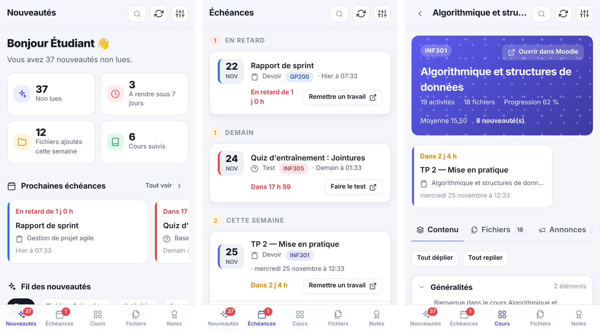
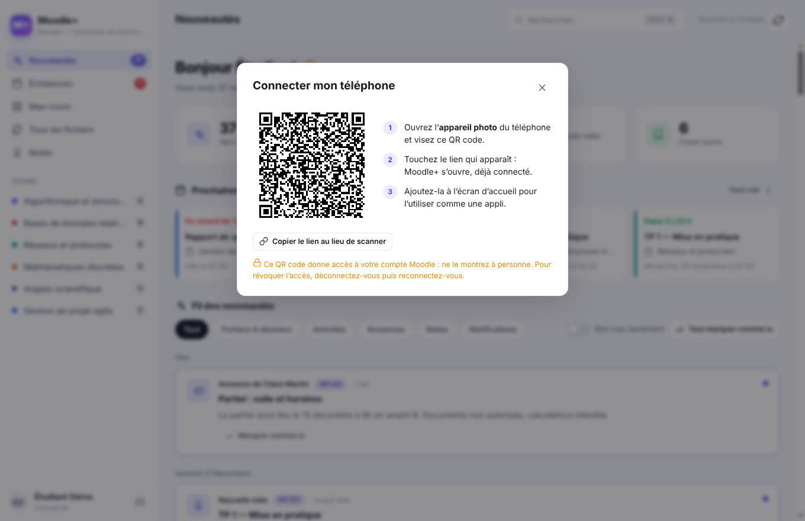
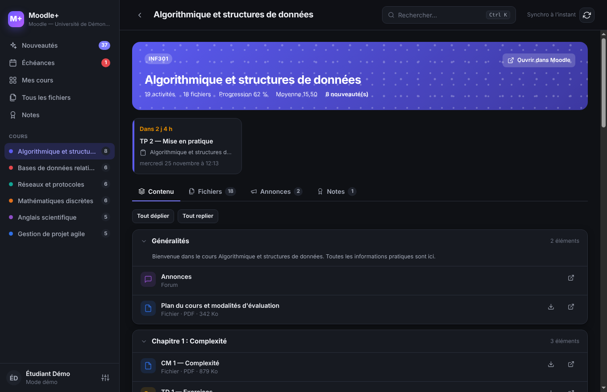

# Moodle+

Application de bureau (Windows, macOS, Linux) qui se connecte à **votre Moodle**, y compris avec la **double authentification**, récupère tout ce qui a changé et l'affiche dans une interface moderne.


## Ce que fait l'application

| | |
|---|---|
| ✨ **Nouveautés** | Un fil, comme une boîte mail, de tout ce qui a été ajouté depuis votre dernière visite : **nouveaux dossiers**, nouveaux fichiers, fichiers mis à jour, nouvelles activités (devoirs, tests…), annonces des enseignants, notes, notifications. Les éléments non lus sont marqués, et vous pouvez filtrer par type. |
| 📅 **Échéances** | Les devoirs et tests à rendre, classés « En retard / Aujourd'hui / Demain / Cette semaine / Plus tard », avec un compte à rebours en couleur. |
| 📚 **Mes cours** | Chaque cours a sa couleur, sa progression, sa moyenne et le nombre de nouveautés. Dans un cours : le contenu par sections (avec un badge **Nouveau**), tous les fichiers dans un tableau triable, les annonces et les notes. |
| 📁 **Tous les fichiers** | Tous les documents de tous vos cours, avec recherche et filtres (PDF, Office, archives…). Ouverture en un clic, ou **« Tout télécharger »** pour récupérer un dossier complet. |
| 🔍 **Recherche** | `Ctrl+K` (ou `⌘K` sur Mac) : recherche instantanée dans les cours, activités, fichiers et annonces. |
| 🔔 **Notifications** | Synchronisation automatique (toutes les 30 min par défaut) et notification du bureau quand quelque chose de nouveau apparaît. |
| 🌙 **Thème sombre** | Suit le thème du système, ou forcé en clair / sombre dans les réglages. |

## 🤖 Appli Android (connexion directe, sans ordinateur)

**Télécharger :** ouvrez ce lien **depuis le téléphone** :
https://github.com/david-ceylon/Moodle-extension/releases/download/android/Moodle-Plus.apk

1. Ouvrez le fichier téléchargé. Android demande d'autoriser l'installation depuis le navigateur (« sources inconnues ») : acceptez, une seule fois.
2. Ouvrez Moodle+ : `moodle.jct.ac.il` est pré-rempli. Touchez **Continuer**, puis **Se connecter**.
3. La vraie page de connexion de votre établissement s'ouvre **dans l'appli** (l'adresse du site est visible en haut). Tapez votre mot de passe et **validez la 2FA**.
4. La page se ferme toute seule et vos cours se chargent.

C'est exactement le mécanisme de l'appli officielle Moodle : un navigateur intégré à l'appli intercepte la redirection finale `moodlemobile://token=…`. Il n'y a **aucun serveur intermédiaire** : votre mot de passe va directement de votre téléphone à votre établissement.

Chaque modification du code reconstruit l'APK automatiquement (workflow **Appli Android**). Pour mettre à jour, retéléchargez-le et installez-le par-dessus : vos données sont conservées.

> **Signature :** par défaut, l'APK est signé avec une clé incluse dans le dépôt (`android/app/moodleplus-public.keystore`). Ça suffit pour un usage personnel. Pour une clé vraiment privée, créez-en une avec `keytool`, puis ajoutez les secrets GitHub `ANDROID_KEYSTORE_BASE64`, `ANDROID_KEYSTORE_PASSWORD` et `ANDROID_KEY_ALIAS`. Attention : changer de clé oblige à désinstaller puis réinstaller l'appli une fois.

## 📱 Sur iPhone (ou sans installer d'APK) : la web-app



La même interface existe en **web-app installable** : elle s'ouvre comme une vraie appli depuis l'écran d'accueil, sans App Store ni Play Store.

**Connexion par QR code (pas de 2FA à refaire)** : un simple site web ne peut pas intercepter la connexion Moodle (contrairement à l'appli Android ou à l'ordinateur). C'est donc l'ordinateur, déjà connecté avec la double authentification, qui la lui transmet :

1. Sur l'ordinateur : **Réglages → Connecter mon téléphone**. Un QR code s'affiche.
2. Sur le téléphone : visez le QR code avec l'**appareil photo** et touchez le lien. Moodle+ s'ouvre, déjà connecté.
3. Pour l'avoir comme une appli : **Partager → Sur l'écran d'accueil** (iPhone, Safari) ou **⋮ → Installer l'application** (Android, Chrome).

Ensuite le téléphone parle **directement** à Moodle : l'ordinateur n'a pas besoin de rester allumé. Le jeton est placé après le `#` du lien, donc il n'est jamais envoyé au site qui héberge l'appli. Il reste stocké uniquement dans le téléphone.

> ⚠️ Le QR code donne accès à votre compte Moodle : ne le montrez à personne.



## 🚀 Déploiement automatique depuis GitHub

Vous n'avez pas besoin de `npm` pour utiliser l'application : **GitHub la construit pour vous**.

### Installateurs pour ordinateur (Windows, Mac, Linux)

1. Sur GitHub, onglet **Actions** → **Application ordinateur** → **Run workflow**.
2. Après environ 10 minutes, les installateurs sont dans **Releases** (colonne de droite de la page du dépôt) : `.exe` pour Windows, `.dmg` pour Mac, `.AppImage` pour Linux.
3. L'application n'est pas signée (une signature coûte environ 100 €/an), donc au premier lancement :
   - **Windows** : « Windows a protégé votre ordinateur » → *Informations complémentaires* → *Exécuter quand même* ;
   - **Mac** : clic droit sur l'app → *Ouvrir* → *Ouvrir*.

Pousser un tag (`git tag v1.1.0 && git push --tags`) déclenche aussi la construction.

### Appli téléphone (GitHub Pages)

Le workflow **Appli téléphone** publie la web-app à chaque modification de la branche principale, à l'adresse
`https://david-ceylon.github.io/Moodle-extension/`. À faire **une seule fois** : *Settings → Pages → Source : GitHub Actions*.

> **Dépôt privé ?** GitHub Pages n'est gratuit que pour les dépôts **publics**. Avec un dépôt privé, il faut un compte GitHub Pro. Il y a deux alternatives gratuites :
> - rendre le dépôt public. Il ne contient **aucun secret** : vos identifiants et votre jeton ne sont jamais dans le code ;
> - ou héberger le dossier `dist-web/` sur Netlify ou Cloudflare Pages, reliés au dépôt, puis indiquer la nouvelle adresse dans *Réglages → Adresse de l'appli téléphone*.

## Installation pour développer

Il faut [Node.js](https://nodejs.org) (version 18 ou plus récente).

```bash
git clone <ce dépôt>
cd Moodle-extension
npm install
npm start
```

Pour voir l'interface **sans compte**, avec des données fictives :

```bash
npm run demo
```

Pour créer un vrai installateur (`.exe`, `.dmg` ou `.AppImage`) dans le dossier `dist/` :

```bash
npm run dist
```

Pour tester la web-app téléphone sur l'ordinateur (`http://localhost:5173`) :

```bash
npm run web
```

## Comment marche la connexion avec double authentification


1. Vous tapez l'adresse de votre Moodle (`moodle.jct.ac.il` est déjà pré-rempli). L'app vérifie le site et affiche son nom et son logo.
2. Vous cliquez sur **Se connecter** : une fenêtre s'ouvre **dans l'application** avec la vraie page de connexion de votre établissement (CAS, Shibboleth, Microsoft, Google…).
3. Vous y tapez votre identifiant et votre mot de passe, puis vous **validez la double authentification** (code SMS, application d'authentification, notification…) dans cette même fenêtre.
4. Quand Moodle a confirmé la connexion, il renvoie un **jeton d'accès**. L'app l'intercepte, ferme la fenêtre et charge vos cours.

C'est exactement le mécanisme de **l'application mobile officielle Moodle** (`admin/tool/mobile/launch.php` → `moodlemobile://token=…`). Conséquences :

- **Votre mot de passe n'est jamais vu ni stocké** par Moodle+ : vous le tapez sur la page officielle.
- Seul le jeton est conservé, **chiffré** par le trousseau du système (Windows / macOS / trousseau Linux) quand il est disponible.
- Les cookies de votre fournisseur d'identité sont gardés : si votre établissement propose « Se souvenir de cet appareil », la 2FA ne sera pas redemandée à chaque fois. Le bouton **« Oublier cet appareil »** (Réglages) efface tout.
- Quand vous cliquez sur « Ouvrir dans Moodle », la page s'ouvre dans une fenêtre de l'app **déjà connectée** (connexion automatique, comme l'appli mobile).

> **Condition :** votre Moodle doit autoriser l'application mobile Moodle (c'est le cas de la grande majorité des universités). Si l'appli *Moodle* officielle fonctionne sur votre téléphone, Moodle+ fonctionnera aussi.

## Comment les nouveautés sont détectées

Moodle ne fournit pas de liste fiable de « ce qui a été ajouté ». À chaque synchronisation, Moodle+ :

1. récupère via l'API officielle (Web Services) vos cours, leur contenu (sections, activités, fichiers avec leurs dates), les annonces, les notes, les échéances et les notifications ;
2. compare avec la **photo prise à la synchronisation précédente** (enregistrée sur votre ordinateur) ;
3. ajoute au fil tout ce qui est apparu ou a été modifié : un nouveau dossier, un fichier ajouté dans un dossier existant, un fichier remplacé, une nouvelle annonce, une note publiée ou modifiée…

À la toute première connexion, il n'y a pas de photo précédente : l'app affiche donc ce qui date de **moins de 14 jours**.

## Structure du code

```
src/
  main/                    processus principal (Node / Electron)
    main.js                fenêtres, synchro automatique, téléchargements, notifications
    auth.js                fenêtre de connexion SSO + 2FA et récupération du jeton
    moodle-client.js       client de l'API Web Services de Moodle
    sync.js                récupération des données + détection des nouveautés
    store.js               stockage local (jeton chiffré)
    demo.js                faux Moodle pour le mode démo
  preload.js               pont sécurisé entre l'interface et le processus principal
  renderer/                interface (Preact + htm, sans compilation), commune ordinateur + téléphone
    index.html, app.js, styles.css
    web-bridge.js          version téléphone du pont (stockage navigateur, jumelage par QR code)
  web/                     manifeste, icônes et service worker de la web-app
scripts/build-web.js       fabrique la web-app dans dist-web/
.github/workflows/         construction automatique (installateurs + GitHub Pages)
test/
  sync.test.js             tests unitaires (npm test)
  mock-moodle-server.js    faux serveur Moodle avec connexion + 2FA (code 123456)
  e2e.js                   test de bout en bout de l'app réelle
  e2e-phone.js             ordinateur (2FA) → QR code → téléphone (émulation iPhone)
  e2e-android.js           connexion directe de l'appli Android (navigateur intégré simulé)
android/                   projet Android (Capacitor) : icônes, signature, version
capacitor.config.json      configuration de l'appli Android (interception de moodlemobile://)
```

## Tests

```bash
npm test                     # tests unitaires (détection des nouveautés, client API, jeton…)
xvfb-run -a node test/e2e.js # (Linux sans écran) lance l'app, se connecte au faux Moodle
                             # en passant par la 2FA, et prend des captures dans screenshots/
```

Vous pouvez aussi lancer le faux Moodle à la main (`node test/mock-moodle-server.js 8099`) puis vous connecter dans l'app à `http://127.0.0.1:8099` (n'importe quel identifiant, code 2FA `123456`).

## Données et confidentialité

Tout reste sur vos appareils : dans le dossier de données de l'application sur l'ordinateur, et dans le stockage du navigateur sur le téléphone. L'app ne parle qu'à votre serveur Moodle, sans aucun serveur intermédiaire.


