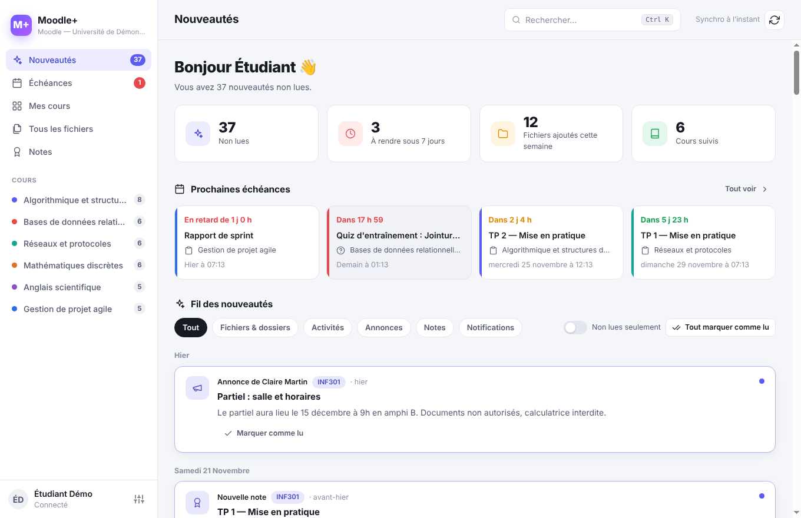
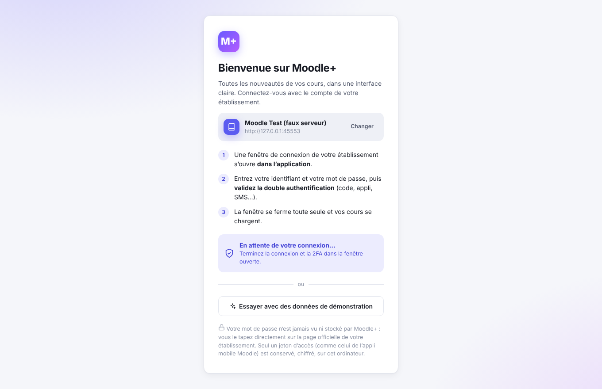

# Moodle+

Application de bureau (Windows, macOS, Linux) qui se connecte à **votre Moodle**, y compris avec la **double authentification**, récupère tout ce qui a changé et l'affiche dans une interface moderne.



## Ce que fait l'application

| | |
|---|---|
| ✨ **Nouveautés** | Un fil, comme une boîte mail, de tout ce qui a été ajouté depuis votre dernière visite : **nouveaux dossiers**, nouveaux fichiers, fichiers mis à jour, nouvelles activités (devoirs, tests…), annonces des enseignants, notes, notifications. Les éléments non lus sont marqués, et vous pouvez filtrer par type. |
| 📅 **Échéances** | Les devoirs et tests à rendre, classés « En retard / Aujourd'hui / Demain / Cette semaine / Plus tard », avec un compte à rebours en couleur. |
| 📚 **Mes cours** | Chaque cours a sa couleur, sa progression, sa moyenne et le nombre de nouveautés. Dans un cours : le contenu par sections (avec un badge **Nouveau**), tous les fichiers dans un tableau triable, les annonces et les notes. |
| 📁 **Tous les fichiers** | Tous les documents de tous vos cours, avec recherche et filtres (PDF, Office, archives…). Ouverture en un clic, ou **« Tout télécharger »** pour récupérer un dossier complet. |
| 🔍 **Recherche** | `Ctrl+K` (ou `⌘K` sur Mac) : recherche instantanée dans les cours, activités, fichiers et annonces. |
| 🔔 **Notifications** | Synchronisation automatique (toutes les 30 min par défaut) et notification du bureau quand quelque chose de nouveau apparaît. |
| 🌙 **Thème sombre** | Suit le thème du système, ou forcé en clair / sombre dans les réglages. |

## Installation

Il faut [Node.js](https://nodejs.org) (version 18 ou plus récente).

```bash
git clone <ce dépôt>
cd Moodle-extension
npm install
npm start
```

Pour voir l'interface **sans compte**, avec des données fictives :

```bash
npm run demo
```

Pour créer un vrai installateur (`.exe`, `.dmg` ou `.AppImage`) dans le dossier `dist/` :

```bash
npm run dist
```

## Comment marche la connexion avec double authentification



1. Vous tapez l'adresse de votre Moodle (par ex. `moodle.mon-universite.fr`). L'app vérifie le site et affiche son nom et son logo.
2. Vous cliquez sur **Se connecter** : une fenêtre s'ouvre **dans l'application** avec la vraie page de connexion de votre établissement (CAS, Shibboleth, Microsoft, Google…).
3. Vous y tapez votre identifiant et votre mot de passe, puis vous **validez la double authentification** (code SMS, application d'authentification, notification…) dans cette même fenêtre.
4. Quand Moodle a confirmé la connexion, il renvoie un **jeton d'accès**. L'app l'intercepte, ferme la fenêtre et charge vos cours.

C'est exactement le mécanisme de **l'application mobile officielle Moodle** (`admin/tool/mobile/launch.php` → `moodlemobile://token=…`). Conséquences :

- **Votre mot de passe n'est jamais vu ni stocké** par Moodle+ : vous le tapez sur la page officielle.
- Seul le jeton est conservé, **chiffré** par le trousseau du système (Windows / macOS / trousseau Linux) quand il est disponible.
- Les cookies de votre fournisseur d'identité sont gardés : si votre établissement propose « Se souvenir de cet appareil », la 2FA ne sera pas redemandée à chaque fois. Le bouton **« Oublier cet appareil »** (Réglages) efface tout.
- Quand vous cliquez sur « Ouvrir dans Moodle », la page s'ouvre dans une fenêtre de l'app **déjà connectée** (connexion automatique, comme l'appli mobile).

> **Condition :** votre Moodle doit autoriser l'application mobile Moodle (c'est le cas de la grande majorité des universités). Si l'appli *Moodle* officielle fonctionne sur votre téléphone, Moodle+ fonctionnera aussi.

## Comment les nouveautés sont détectées

Moodle ne fournit pas de liste fiable de « ce qui a été ajouté ». À chaque synchronisation, Moodle+ :

1. récupère via l'API officielle (Web Services) vos cours, leur contenu (sections, activités, fichiers avec leurs dates), les annonces, les notes, les échéances et les notifications ;
2. compare avec la **photo prise à la synchronisation précédente** (enregistrée sur votre ordinateur) ;
3. ajoute au fil tout ce qui est apparu ou a été modifié : un nouveau dossier, un fichier ajouté dans un dossier existant, un fichier remplacé, une nouvelle annonce, une note publiée ou modifiée…

À la toute première connexion, il n'y a pas de photo précédente : l'app affiche donc ce qui date de **moins de 14 jours**.

## Structure du code

```
src/
  main/                    processus principal (Node / Electron)
    main.js                fenêtres, synchro automatique, téléchargements, notifications
    auth.js                fenêtre de connexion SSO + 2FA et récupération du jeton
    moodle-client.js       client de l'API Web Services de Moodle
    sync.js                récupération des données + détection des nouveautés
    store.js               stockage local (jeton chiffré)
    demo.js                faux Moodle pour le mode démo
  preload.js               pont sécurisé entre l'interface et le processus principal
  renderer/                interface (Preact + htm, sans compilation)
    index.html, app.js, styles.css
test/
  sync.test.js             tests unitaires (npm test)
  mock-moodle-server.js    faux serveur Moodle avec connexion + 2FA (code 123456)
  e2e.js                   test de bout en bout de l'app réelle
```

## Tests

```bash
npm test                     # tests unitaires (détection des nouveautés, client API, jeton…)
xvfb-run -a node test/e2e.js # (Linux sans écran) lance l'app, se connecte au faux Moodle
                             # en passant par la 2FA, et prend des captures dans screenshots/
```

Vous pouvez aussi lancer le faux Moodle à la main (`node test/mock-moodle-server.js 8099`) puis vous connecter dans l'app à `http://127.0.0.1:8099` (n'importe quel identifiant, code 2FA `123456`).

## Données et confidentialité

Tout reste sur votre ordinateur, dans le dossier de données de l'application (`%APPDATA%/moodle-plus` sous Windows, `~/Library/Application Support/moodle-plus` sous macOS, `~/.config/moodle-plus` sous Linux). L'app ne parle qu'à votre serveur Moodle.


